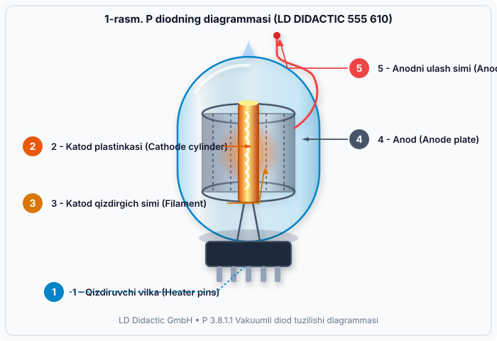

# OLabs — Vakuumli Diodning Volt-Amper Xarakteristikasini O'rganish (LD FIZIKA P 3.8.1.1)

O'zbekiston maktablari, litseylari va oliy ta'lim muassasalari talabalari uchun yaratilgan interaktiv virtual fizika laboratoriyasi. Mazkur loyiha **OLabs (Online Labs)** platformasi tuzilishi hamda **LD DIDACTIC GmbH P 3.8.1.1** rasmiy laboratoriya dasturiga to'liq mos holda ishlab chiqilgan.



---

## 🌟 Asosiy Imkoniyatlar va Bo'limlar

### 1. 🔬 Virtual Simulyator (`cnt=4`)
- **Real vaqtda 60 FPS Canvas laboratoriya stoli:**
  - Vakuum shisha kolbasi (LD 555610)
  - Dinamik qizdiriluvchi volfram katod spirali va harorat indikatori ($T \approx 1100\text{ K} - 1450\text{ K}$)
  - Katoddan elektronlarning termoemissiyasi va xajmiy manfiy zaryad buluti
  - Anod musbat maydoni ta'sirida elektronlarning tezlanishi va to'qnashuv chaqnashlari
  - Teskari qutblanishda manfiy maydon elektronlarni itarishi (to'g'rilagichlik xossasi)
- **Ko'rinish rejimlari:** Realistik laboratoriya apparati va Prinsipial elektr sxemasi (Schematic).
- **Quvvat manbalari:**
  - Katod qizdirish manbai: $U_f$ (4.0 V, 5.0 V, 6.3 V presetlari va silliq slayder)
  - Yuqori kuchlanishli tartiblangan anod manbai: $U_A$ ($0 - 250\text{ V}$, $\pm 1\text{V}, \pm 5\text{V}, \pm 10\text{V}, \pm 25\text{V}$ tezkor qadam tugmalari)
- **Avtomatlashtirilgan o'lchovlar:**
  - `➕ Jadvalga qo'shish` — joriy o'lchovni qayd qilish
  - `⚡ Avtomatik o'lchash (0–240V)` — joriy $U_f$ uchun 14 ta nuqtani avtomatik olish
  - `✨ Barcha 3 ta VAX egri chizig'ini olish` — 3 ta qizdirish kuchlanishining barchasini birdaniga o'lchash
  - `🔄 Qayta o'rnatish`

### 2. 📊 O'lchovlar Jadvali (Worksheet / SigmaGrid)
- Avtomatik hisoblanuvchi ustunlar: $U_f$, $U_A$, $I_A$, $U_A^{3/2}$, $\ln(U_A)$, $\ln(I_A)$, ish sohasi.
- Filtrlash ($U_f = 4.0\text{V}, 5.0\text{V}, 6.3\text{V}$, Barchasi).
- **Excel / CSV formatida eksport qilish** va hisobotni chop etish.

### 3. 📈 Interaktiv Grafik Tahlili (Chart Engine)
- **VAX: $I_A = f(U_A)$** — 3 xil harorat uchun egri chiziqlar va to'yinish sohalari.
- **Lengmyur-Chayld tekshiruvi: $\ln(I_A)$ vs $\ln(U_A)$** — chiziqli regressiya qiyaligi $n \approx 1.50$ ($3/2$ daraja qonuni isboti) va $R^2$ aniqlik koeffitsienti.
- **$I_A$ vs $U_A^{3/2}$** — to'g'ri chiziqli bog'liqlik grafigi.

### 4. 📚 To'liq Laboratoriya Sahifalari
- 📖 **Nazariya (Theory):** LD Didactic P 3.8.1.1 rasmiy matni, vektorli 1-rasm va 2-rasm diagrammalari, Richardson-Dushman va Lengmyur-Chayld qonunlari.
- 📋 **Jarayon (Procedure):** Asboblar ro'yxati, xavfsizlik texnikasi va 7 bosqichli ko'rsatma.
- 🎥 **Video va Animatsiya:** Kristall panjaradan elektronlar chiqishi mikroskopik animatsiyasi.
- 📝 **O'z-o'zini baholash (Quiz):** 6 ta test savoli, javoblar tahlili va konfetti effekti.
- 📑 **Laboratoriya Hisoboti (Report Generator):** Talaba nomi, guruhi va olingan natijalari bilan rasmiy varaqani chop etish.
- 📰 **Yangiliklar**, 🎓 **Seminarlar**, 📥 **Qo'llanmalar yuklab olish** va 📞 **Bog'lanish** sahifalari.

---

## 🚀 O'rnatish va Ishga Tushirish

```bash
# 1. Repozitoriyani klonlash
git clone https://github.com/sardorbek-3226/olabs-vacuum-diode.git

# 2. Loyiha papkasiga o'tish
cd olabs-vacuum-diode

# 3. Bog'liqliklarni o'rnatish
npm install

# 4. Mahalliy dev serverni ishga tushirish
npm run dev

# Brauzerda ochish:
# http://localhost:3000/
```

## 🛠️ Texnologiyalar
- **Frontend:** React 19, Vite
- **Styling:** Vanilla CSS (OLabs Maroon Design System)
- **Grafika:** HTML5 Canvas 2D Engine, Scalable Vector Graphics (SVG)
- **Ikonkalar:** Lucide React
- **Matematika:** Richardson-Dushman emissiyasi, Lengmyur-Chayld 3/2 qonuni, Shottki effekti va chiziqli regressiya

---

© 2026 OLabs • O'zbekiston Virtual Laboratoriyalar Portali
